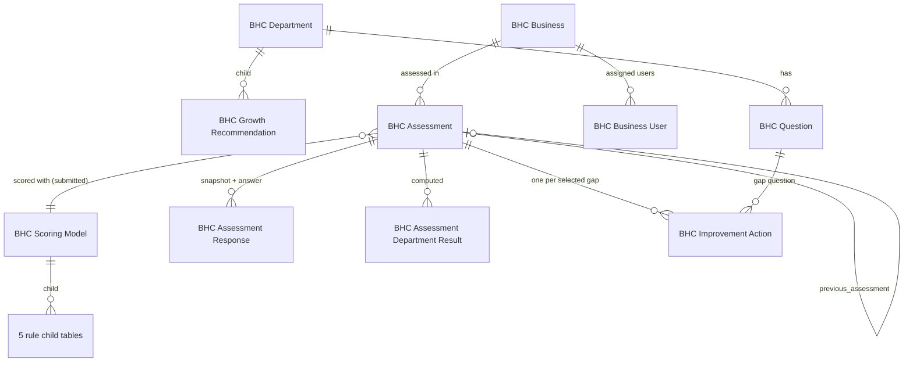

# Data model

Status: **implemented in Phases 2–4 (2026-10-27)** for masters, scoring models, businesses, assessments, results, gap analysis, comparison, improvement actions and the 90-day plan. KPI reviews and growth decisions are still proposals (§7). Formula provenance stays in [workbook_audit.md](workbook_audit.md); W-xx are its findings and Q-xx are [open questions](open_questions.md).

The DocType JSON files under `business_health_checkup/business_health_checkup/doctype/` are the source of truth; the field tables in §10 are generated from them.

## 1. Principles (unchanged from the Phase 1 proposal)

- **One scoring implementation.** Every score comes from `business_health_checkup/scoring.py`. The only bridge between DocTypes and the engine is `business_health_checkup/assessments.py`; no controller, form script or report re-implements a formula. The browser never calculates a score.
- **Finalised means frozen.** An assessment stores its own copy of each question as asked, its answers and evidence, a link to an immutable scoring-model version, that version's rules fingerprint, and all computed results. Master edits never touch it.
- **Each re-assessment is its own record**, linked to the one before.
- **Isolation fails closed.** No assignment means no access (§6).
- Names start with `BHC`; module **Business Health Checkup**.

## 2. Overview

| DocType | Kind | Workbook source | Records after import |
|---|---|---|---|
| BHC Department (+ BHC Growth Recommendation) | master | SETTINGS!A41:D50, RECOMMENDATION MASTER | 10 (70 recommendations) |
| BHC Question | master | QUESTION MASTER | 150 |
| BHC Scoring Model (+ BHC Answer Score, BHC Criticality Weight, BHC Maturity Band, BHC Priority Matrix Entry, BHC Priority Rule) | submittable, versioned | SETTINGS!A4:I29 | 1 (“Workbook v1”, default) |
| BHC Business (+ BHC Business User) | master | COMPANY PROFILE!B4:C21 | — |
| BHC Assessment (+ BHC Assessment Response, BHC Assessment Department Result) | submittable | department sheets, SCORE CALCULATION | — |
| BHC Improvement Action | transaction (status lifecycle, not submittable) | ACTION PLAN!A7:Q207 | — (Phase 4) |

Changes from the Phase 1 proposal:

- The Business child table is **BHC Business User** (field `assigned_users`), editable only by System Managers (permlevel 1).
- Department results are **BHC Assessment Department Result** and also store the workbook’s growth-plan status (brief, Phase 2 §5).
- Scores and completion on assessments and department results are **Percent fields (0–100)** for readability; scoring-model parameters stay fractions 0–1, as in SETTINGS. The engine works in fractions; `assessments.py` multiplies by 100 when storing.
- No Customer link on Business (Q-13 open); no profile snapshot on the assessment (Q-13/W-20 open). Either can be added later without touching the engine.
- Department has no enabled/disabled flag: the workbook’s departments are structural. Questions have `is_active`, which only decides whether new assessments include them.

## 3. Masters

**BHC Department** — named by its code. Validation: code is 2–10 capital letters/digits and can never change; display order ≥ 1 and unique; growth-recommendation seq unique. Every imported value keeps its source cell (`source_reference`, `business_risk_reference`, recommendation `source_reference`).

**BHC Question** — named by its question ID. Validation: ID = department code + `-` + number (QUESTION MASTER convention, e.g. STR-01, QA-16) and can never change; seq ≥ 1 and unique within the department; question text required; criticality one of Critical / Important / Standard / Basic. The weight is not stored on the question: as in the workbook (QUESTION MASTER!G = lookup of criticality in SETTINGS), it comes from the scoring model, and each assessment copies it. Changing a question’s criticality therefore changes its weight in assessments created afterwards only.

Question order in an assessment = department display order, then seq, then ID (deterministic).

## 4. Scoring models

A **BHC Scoring Model** is one version of the SETTINGS rules. Its child tables mirror SETTINGS and the `rules.json` layout, and `get_rules()` turns it into `scoring.Rules`.

- **Validation** (`get_problems`): YES / PARTIALLY / NO / N/A exactly once each, fractions 0–1, and only N/A excluded (the workbook tests `"N/A"` literally); the four criticalities once each with weight > 0; maturity lower bounds unique, within 0–1, lowest = 0, labels unique; a priority for NO and PARTIALLY of every criticality; HIGH / MEDIUM / LOW rules once each with unique rank ≥ 1 and due ≥ start; thresholds within 0–1 and growth ≤ strength; finally the engine must accept the rules.
- **Fingerprint**: `rules_hash` = SHA-256 of the rule values in a fixed order (row order does not matter). Every assessment stores the fingerprint of the model it was scored with.
- **Immutability**: submitted versions cannot be edited (Frappe raises `UpdateAfterSubmitError`); only `is_default` may change after submission. A version that a finalised assessment links to cannot be cancelled (`LinkExistsError`).
- **New version**: create (or amend) a model, submit it, tick *Default for New Assessments*; the previous default is cleared. Only a submitted model can be the default.
- **Who**: System Manager only (create, submit, cancel, amend, set default). BHC roles can read. Provisional, Q-12.

## 5. Businesses and assessments

### 5.1 BHC Business

Fields are the COMPANY PROFILE inputs (C4:C21), with `industry` limited to the 18 values of SETTINGS!G34:G51 and basic checks (non-negative counts and turnover, export % 0–100, plausible year). The consultant is recorded per assessment instead of on the business (W-18). `assigned_users` controls access (§6).

### 5.2 BHC Assessment

| Step | What happens | Code |
|---|---|---|
| Insert | scoring model defaults to the default model; every active question is copied into `responses` with text, criticality, the model’s weight, recommendation, KPI and risk; answers/evidence passed by an API caller are kept by question ID, everything else comes from the master; sequence no. and label (“Assessment 1 - Baseline”, “Assessment n”) are set | `before_insert`, `assessments.build_snapshot` |
| Every draft save | business and scoring model must be unchanged; the snapshot (rows, order and every copied field) must be unchanged; the model must be submitted; the previous assessment must be a finalised assessment of the same business, not dated later; then the engine scores the snapshot and writes question results (earned, max, gap, priority, gap rank), one department result per department, overall totals, model version, fingerprint, calculation time and the suggested re-assessment date (assessment date + 90, MANAGEMENT REPORT!B113, a suggestion only) | `validate`, `assessments.calculate` |
| Submit (“Finalised”) | the engine is re-run on the stored snapshot and must reproduce every stored figure; an alert says how many questions are unanswered (they are excluded, INSTRUCTIONS!C11); no completeness rule is enforced (Q-04) | `before_submit`, `assessments.stored_result_differences` |
| After submit | Frappe allows no field to change; nothing re-scores it | standard submission |
| Cancel / amend | System Manager only. An amendment must keep the business, the scoring model and the exact question snapshot of the original; answers can be corrected | `assessments.check_amendment_snapshot` |

Answers are a Select (blank / YES / PARTIALLY / NO / N/A); blank means unanswered and N/A means not applicable — both are excluded from earned and max, N/A counts as answered (W-17, Q-16). An answer outside the model’s answer set is rejected by the engine as well as by the Select. Values a caller sends for calculated fields are overwritten.

Departments with no applicable answer keep the workbook behaviour: score 0, maturity “Not Assessed”, growth status “PRIORITY - GROWTH PLAN” (W-01). The result row’s `assessed` flag (max > 0) lets later reports treat them differently once Q-04 is decided.

### 5.3 Services (`business_health_checkup.assessments`, whitelisted, permission-checked)

| Method | Does |
|---|---|
| `make_reassessment(source_name)` | new unsaved draft for the same business with `previous_assessment` = the finalised source, the current default model and blank answers (the form’s *Create → Re-assessment* button) |
| `verify_results(name)` | re-runs the engine on the stored snapshot and model and lists any stored figure that differs (read-only; the form’s *Verify Results* button) |
| `get_results_summary(name)` | the form’s Results Summary: overall result, coverage, answered / N/A / unanswered counts, gap counts, department rows (§5.4), previous assessment and re-assessments (Phase 3) |
| `get_comparison(name)` | the assessment against its linked previous assessment (§5.5) (Phase 3; replaces the Phase 2 raw version) |

Improvement-action services are in `business_health_checkup.actions` (§5.7): `get_eligible_gaps(assessment)`, `create_actions(assessment, questions, responsible, responsible_user, use_suggested_dates)`, and the link queries `gap_question_query` and `responsible_user_query`.

### 5.4 Department results, ranking and coverage (Phase 3)

`assessments.department_rows(doc)` returns, for every stored department result, the stored figures plus three derived values. All three are computed from stored values only (results, answers, row order), so they are the same for a finalised assessment whatever the masters say today:

| Value | Rule | Source |
|---|---|---|
| `workbook_rank` | `scoring.rank_departments`: RANK of score + ROW()/1000000, 1 = weakest, departments in their stored order; unassessed departments take part with 0 | SCORE CALCULATION!T5:U14 (W-09, Q-04, Q-21) |
| `coverage` | `analysis.coverage_state`: “Not assessed (no answers)”, “Not assessed (all N/A)”, “Partly answered”, “Fully answered” (facts, not a judgement; “Not assessed” = the workbook’s “Not Assessed”, applicable max 0) | answered / N/A counts |
| `repeated_problem_area` | `scoring.repeated_problem_area`: ≥ 3 HIGH gaps → “YES - 3+ HIGH gaps: systemic weakness”, else ≥ 8 gaps → “YES - many gaps in one function” | GAP ANALYSIS!H7:H16 (literals, W-07) |

plus `not_applicable`, `applicable`, `unanswered`. The rank is derived rather than stored, so it needed no schema change and is available for assessments finalised before Phase 3. A stored 0 % of a not-assessed department is kept (workbook parity) but always shown next to its coverage and greyed out, so it is never presented as a measured low score.

### 5.5 Comparison with the previous assessment (Phase 3)

`assessments.get_comparison` loads both assessments (read permission on each), turns their stored results into plain dicts (`assessment_view`) and calls `analysis.compare`. It writes nothing and never re-scores either side.

- **Matching**: departments by code, questions by question ID.
- **Question changes**: *added* (only in the current snapshot), *removed* (only in the previous one), *changed* (in both, but department, question text, criticality or weight differ in the snapshots).
- **Difference**: current score − previous score in percentage points, for each department and overall, **only when both sides have applicable answers**; otherwise `None` (never a “change against 0”).
- **Comparable**: Yes only if both sides are assessed, the rules fingerprints are equal, and (for a department) none of its questions was added, removed or changed — (overall) no question at all changed.
- **Limitations** (listed with every row): different scoring rules (with both version labels), a side not assessed or missing, each added/removed/changed question, different questions answered (informational, Q-19), previous assessment not Finalised.
- **Question rows**: previous and current answer and earned / max for every question, with its state (In both / Added / Removed) and snapshot changes.
- No wording such as “improved” or “declined” is produced (Q-11).

### 5.6 Results in the form (Phase 3)

BHC Assessment has a **Results Summary** section (HTML field `results_summary`, no database column) filled by `get_results_summary`: overall score, maturity and coverage; answered / N/A / unanswered; HIGH / MEDIUM / LOW gaps; a department table ordered by workbook rank with coverage pills (grey = not assessed, orange = partly answered, blue = fully answered), not-assessed 0 % greyed out; links to the previous assessment and to re-assessments. *View* buttons open the reports (Gap Analysis, Department Results, 90 Day Plan, Comparison) and the action list filtered to the assessment; a finalised assessment also has *Create → Improvement Actions* (§5.7), and the summary shows how many of its gaps have an action, by status. The Connections tab lists re-assessments and improvement actions and, on BHC Business, its assessments and actions. The list view shows a status indicator. None of this calculates anything in the browser.

### 5.7 Improvement actions (Phase 4)

**Gap, recommendation, action.** A *gap* is a stored response of a finalised assessment with gap points > 0; its priority was scored with that assessment’s scoring model. Its *recommendation* is the question’s recommendation as copied into the assessment. An *action* (BHC Improvement Action) exists only when a user creates it for a gap — nothing is created automatically, not even on finalising (Q-07, provisional). The department *growth status* (BUSINESS GROWTH PLAN) is a separate label and never creates an action (Q-05, Q-22).

**Creating.** *Create → Improvement Actions* on a finalised assessment lists its gaps without an action, in gap order, with priority, phase and recommendation; the user ticks the ones to act on (nothing is pre-ticked) and may set a responsible name/user for all of them and ask for the suggested dates to be used as agreed dates. `actions.create_actions` checks every selected question against the stored gaps before writing anything and inserts inside a savepoint, so a failing request creates nothing. Actions can also be created one at a time from the action form (assessment + gap question).

**One action per gap.** The workbook has one ACTION PLAN row per question, so `source_key` = “assessment|question ID” is unique: a retried request returns the existing action, and a second action for the same gap is refused by the database (Q-25).

**What is copied (read-only for ever).** Business, assessment, assessment date, scoring model and version, question ID / text / department / answer / criticality / weight, gap points, gap rank, priority, 90-day phase, suggested start and due dates, recommendation, KPI and business risk — all from the source assessment on the server; values a caller sends are replaced on insert and refused on update. Master edits, new scoring models, re-scoring other assessments and re-assessments therefore never change an action.

**Phase and dates.** Phase = the source model’s phase for the gap’s priority (SETTINGS!G20:G22: HIGH 0-30 Days, MEDIUM 31-60 Days, LOW 61-90 Days). Suggested start / due = assessment date + the model’s start / due days (0/30, 31/60, 61/90; SCORE CALCULATION!T25:U25). Without an assessment date there are no suggested dates — nothing falls back to today. Suggested dates never change (the source is frozen) and are not agreed dates: *Start Date* and *Target Date* are blank until the user enters them or ticks “use the suggested dates”. Agreed dates must be after 1 January 2000 (ACTION PLAN!L8:M207) and the target cannot be before the start.

**Responsible (Q-14, provisional).** `responsible` is free text as in ACTION PLAN K (a person without a login is fine). `responsible_user` is an optional User who must be enabled and already able to see the business (Assigned Users, or System Manager); if `responsible` is blank it takes the user’s full name. Naming a user never gives access.

**Status lifecycle.** Open (default) → In Progress / Hold / Completed, in any order, as the workbook’s dropdown allows (SETTINGS!A34:A37). When the status becomes Completed the system sets *Completed On* to that day; it cannot be typed or moved, and it stays when the completed action is edited later. Taking an action out of Completed clears it and is allowed only for BHC Manager and System Manager (Q-24); the old value remains in the version log (`track_changes`). No status is set automatically by finalising, re-assessing or anything else. There is no Cancelled status (Q-23); deletion is System Manager only, and an assessment with actions cannot be deleted.

**Overdue** (computed when listed, never stored): an agreed Target Date before today and status not Completed (ACTION PLAN!Q8). A suggested due date never makes an action overdue; an action without an agreed target is never overdue.

## 6. Roles and record-level access

| Role | Masters, scoring models | BHC Business | BHC Assessment | BHC Improvement Action |
|---|---|---|---|---|
| System Manager (administrator) | full | full, incl. Assigned Users; all businesses | full incl. submit, cancel, amend, delete; all businesses | full incl. delete; all businesses |
| BHC Manager | read | assigned only: read | assigned only: read, write, submit | assigned only: create, read, write, reopen a completed action |
| BHC Consultant | read | assigned only: read, write profile | assigned only: create, read, write (draft) | assigned only: create, read, write (not reopen) |
| any other user | none | none | none | none |

An action belongs to the business of its source assessment. List queries filter on the action’s stored `business` (always set from the source); document checks look the business up from the source assessment in the database, so a request naming one business and a source from another is refused. Being the responsible person gives no access.

The four reports (§9) are allowed for System Manager, BHC Manager and BHC Consultant, and every report reads assessments through the same permission-filtered query (§9), so the table applies to them unchanged.

Implementation (`business_health_checkup/permissions.py`, wired in `hooks.py`):

- `permission_query_conditions` for BHC Business and BHC Assessment restrict every list, count, report view, link search and child-table query (Frappe v16 joins the parent’s conditions into child-table queries) to businesses whose Assigned Users include the user. A user with no assignment gets an empty result, never everything.
- `has_permission` hooks deny document access (read, write, submit, print …) outside the assigned businesses, including direct calls by document name.
- A `DocShare` validate hook refuses every share of BHC Business / BHC Assessment. Frappe lets a share override both hooks, and “Assign To” shares automatically with an assignee who lacks access; blocking shares closes both routes. Access is granted only through Assigned Users.
- System Manager and Administrator are unrestricted by explicit policy. Ordinary users cannot gain that through these hooks.
- Response rows and department results have no permissions of their own; Frappe checks the parent assessment.

All of this is provisional pending Q-03, Q-06, Q-12 and Q-18 (see open_questions.md for what changes with each answer).

## 7. Not built yet (proposals unchanged)

- **Growth decisions** (Phase 3) — manager’s decision per department on the growth programme. *Pending Q-05.*
- **BHC KPI Review** (Phase 6) — per business per period. *Pending Q-10.*
- Print formats and the management report / owner dashboard (Phase 5).

## 8. Historical integrity — what is enforced and tested

| Risk in the workbook | Implemented answer | Test |
|---|---|---|
| Past scores follow today’s weights (W-02) | weight/criticality copied per response; model linked and immutable; no re-scoring after submit | `test_master_changes_and_new_rules_leave_a_finalised_assessment_alone` |
| Question text edited later (W-02) | text, recommendation, KPI, risk copied | same; `test_snapshot_cannot_be_edited` |
| Shared evidence column (W-03) | evidence per response per assessment | `test_response_rows_follow_the_parent` |
| “Previous” = number − 1 (W-05) | explicit link to a finalised assessment of the same business | `test_previous_assessment_rules` |
| Blank date = today (W-06) | assessment date required | DocType (`reqd`) |
| Bad input scored silently (W-16) | Select + engine validation | `test_invalid_answer_is_rejected_and_a_retry_works` |
| Results typed in by hand | calculated fields always overwritten from the engine | `test_results_supplied_by_the_caller_are_replaced`, `test_results_cannot_be_set_through_the_api` |
| Action status tied to a question slot (W-04) | an action belongs to one assessment’s gap and copies its context | `test_actions_trace_to_their_source`, `test_reassessment_copies_no_actions` |
| Action context rewritten by master or rule changes | gap, priority, phase and suggested dates copied at creation, read-only | `test_master_and_scoring_changes_leave_actions_alone`, `test_source_fields_cannot_be_edited` |
| Re-scoring another assessment changes an action | actions read nothing from other assessments | `test_scoring_another_assessment_does_not_touch_actions` |
| Completion history overwritten | completion date set by the system, kept on later edits; reopening restricted and logged | `test_completion_date_is_set_by_the_server`, `test_reopening_needs_a_manager` |

## 9. Reports (Phases 3–4)

All four are standard **Script Reports** (three on BHC Assessment, the 90 Day Plan on BHC Improvement Action) (module Business Health Checkup, roles System Manager / BHC Manager / BHC Consultant). The assessment reports start from `reporting.permitted_assessments` and the 90 Day Plan from `frappe.get_list` on actions; both use `frappe.get_list` and so the record-level rules of §6: a filter can only narrow what the user may read. Child rows are then read only for those assessments. A Link filter naming an inaccessible business or assessment is refused by Frappe’s own filter check on the report page; a direct API call that skips that check gets no rows (Gap Analysis, Department Results) or a permission error (Comparison) from the report itself. Cancelled assessments are left out unless *Assessment Status* = Cancelled (Q-20).

| Report | Rows | Filters | Workbook source |
|---|---|---|---|
| **BHC Gap Analysis** | one per stored response with gap points > 0, in stored gap rank: business, assessment, date, status, gap no., department, question ID, question (snapshot), criticality, weightage, answer, earned, max, gap points, priority, recommendation, KPI, business risk, 90-day phase (from the assessment’s own scoring model), improvement action and its status (Phase 4); summary: total gaps, HIGH, MEDIUM, LOW, points lost, overall score (single assessment); chart: gaps per department by priority | business, assessment, assessment status, department, criticality, priority, answer (NO / PARTIALLY) | GAP ANALYSIS!A18:N218, B4:G4 |
| **BHC Department Results** | one per department per assessment (§5.4): rank (workbook), coverage, questions, answered, N/A, unanswered, completion, earned, max, score, maturity, gap counts, growth plan status (workbook), repeated problem area | business, assessment, assessment status, department, coverage, sort by (rank weakest first / department order) | SCORE CALCULATION!A5:U14, GAP ANALYSIS rows 7–16, BUSINESS GROWTH PLAN!A8:E17 |
| **BHC 90 Day Plan** (ref. BHC Improvement Action) | one per action the user may read, by source assessment then gap rank: business, assessment, date, source status, action, phase (suggested), priority, gap no., department, question, agreed action, responsible, responsible user, suggested start / due, agreed start / target, status, completed on, overdue, KPI, target / measure; summary: total, Open, In Progress, Completed, On Hold, Overdue, Completion % (ACTION PLAN!A4:G4), actions without an agreed target date, and — when one finalised assessment is selected — gaps without an action; chart: actions per phase by status | business, assessment, department, priority, phase, status, responsible (contains), responsible user, target date from / to (only actions with a target date), overdue only | 90 DAY PLAN, ACTION PLAN!A4:Q207 (suggested and agreed dates in separate columns, W-23) |
| **BHC Assessment Comparison** | an Overall row and one per department (§5.5), or one per question (*Show* = Questions); message lists both assessments (date, status, scoring version) and the general limitations | assessment (required; compared with its previous assessment), show | none — the workbook’s S5 change column is replaced by §5.5 |

## 10. Fields (generated from the DocType JSON)

#### BHC Department

`master/transaction` · naming `field:department_code`

| Field | Type | Notes |
|---|---|---|
| `department_code` (Department Code) | Data | required, unique, set once |
| `department_name` (Department) | Data | required |
| `chart_label` (Chart Label) | Data |  |
| `display_order` (Display Order) | Int | required |
| `sheet_name` (Workbook Sheet) | Data | read-only |
| `source_reference` (Source cell) | Data | read-only |
| `business_risk` (Business Risk if the Function Stays Weak) | Small Text |  |
| `growth_recommendations` (Growth Recommendations) | Table | → BHC Growth Recommendation |
| `business_risk_reference` (Business Risk Source Cell) | Data | read-only |

#### BHC Growth Recommendation

`child table`

| Field | Type | Notes |
|---|---|---|
| `seq` (Seq) | Int | required |
| `recommendation` (Growth Recommendation) | Small Text | required |
| `source_reference` (Source cell) | Data | read-only |

#### BHC Question

`master/transaction` · naming `field:question_code`

| Field | Type | Notes |
|---|---|---|
| `question_code` (Question ID) | Data | required, unique, set once |
| `department` (Department) | Link | → BHC Department, required |
| `seq` (Seq) | Int | required |
| `criticality` (Criticality) | Select | Critical / Important / Standard / Basic, required |
| `is_active` (Active) | Check |  |
| `source_reference` (Source cell) | Data | read-only |
| `sub_category` (Sub-Category) | Data |  |
| `question` (Question) | Small Text | required |
| `recommendation` (Recommendation) | Small Text |  |
| `kpi` (KPI) | Small Text |  |
| `business_risk` (Business Risk if Unresolved) | Small Text |  |

#### BHC Scoring Model

`submittable` · naming `BHC-SM-.####`

| Field | Type | Notes |
|---|---|---|
| `version_label` (Version) | Data | required |
| `is_default` (Default for New Assessments) | Check | editable after submit |
| `rules_hash` (Rules Fingerprint) | Data | read-only |
| `source_reference` (Source) | Data | read-only |
| `description` (Description) | Small Text |  |
| `amended_from` (Amended From) | Link | → BHC Scoring Model, read-only |
| `answer_scores` (Answer Scores) | Table | → BHC Answer Score, required |
| `criticality_weights` (Criticality Weights) | Table | → BHC Criticality Weight, required |
| `maturity_bands` (Maturity Bands) | Table | → BHC Maturity Band, required |
| `priority_matrix` (Priority Matrix) | Table | → BHC Priority Matrix Entry, required |
| `priority_rules` (Priority Rules) | Table | → BHC Priority Rule, required |
| `growth_plan_threshold` (Growth Plan Trigger (department score below)) | Float | required |
| `strength_threshold` (Strength (department score at or above)) | Float | required |
| `kpi_watch_tolerance` (KPI Watch Tolerance) | Float |  |

#### BHC Answer Score

`child table`

| Field | Type | Notes |
|---|---|---|
| `answer` (Answer) | Select | YES / PARTIALLY / NO / N/A, required |
| `score_fraction` (Share of Weight Earned) | Float | required |
| `excluded` (Excluded from Score) | Check |  |
| `source_reference` (Source cell) | Data | read-only |

#### BHC Criticality Weight

`child table`

| Field | Type | Notes |
|---|---|---|
| `criticality` (Criticality) | Select | Critical / Important / Standard / Basic, required |
| `weight` (Weight (points)) | Float | required |
| `source_reference` (Source cell) | Data | read-only |

#### BHC Maturity Band

`child table`

| Field | Type | Notes |
|---|---|---|
| `lower_bound` (Lower Bound (score >=)) | Float | required |
| `upper_bound_display` (Upper Bound (display only)) | Float |  |
| `label` (Maturity Level) | Data | required |
| `short_label` (Short Label) | Data |  |
| `meaning` (Meaning) | Small Text |  |
| `source_reference` (Source cell) | Data | read-only |

#### BHC Priority Matrix Entry

`child table`

| Field | Type | Notes |
|---|---|---|
| `criticality` (Criticality) | Select | Critical / Important / Standard / Basic, required |
| `answer` (Answer) | Select | NO / PARTIALLY, required |
| `priority` (Priority) | Select | HIGH / MEDIUM / LOW, required |
| `source_reference` (Source cell) | Data | read-only |

#### BHC Priority Rule

`child table`

| Field | Type | Notes |
|---|---|---|
| `priority` (Priority) | Select | HIGH / MEDIUM / LOW, required |
| `rank_score` (Rank Score) | Int | required |
| `phase` (90-Day Phase) | Data | required |
| `start_offset_days` (Start (days after assessment)) | Int |  |
| `due_offset_days` (Due (days after assessment)) | Int |  |
| `source_reference` (Source cell) | Data | read-only |

#### BHC Business

`master/transaction` · naming `BHC-BUS-.#####`

| Field | Type | Notes |
|---|---|---|
| `business_name` (Company Name) | Data | required |
| `contact_person` (Contact Person) | Data |  |
| `designation` (Designation) | Data |  |
| `mobile` (Mobile) | Data |  |
| `email` (Email) | Data |  |
| `industry` (Industry) | Select | 18 workbook values |
| `product_category` (Product Category) | Data |  |
| `location` (Location (City, State)) | Data |  |
| `year_established` (Year Established) | Int |  |
| `number_of_employees` (Number of Employees) | Int |  |
| `annual_turnover_lakh` (Annual Turnover (Rs Lakh)) | Float |  |
| `export_percent` (Export %) | Percent |  |
| `number_of_customers` (Number of Customers) | Int |  |
| `major_customers` (Major Customers) | Small Text |  |
| `number_of_plants` (Number of Plants) | Int |  |
| `production_processes` (Production Processes) | Small Text |  |
| `consultancy_firm` (Consultancy Firm) | Data |  |
| `assigned_users` (Assigned Users) | Table | → BHC Business User, permlevel 1 |

#### BHC Business User

`child table`

| Field | Type | Notes |
|---|---|---|
| `user` (User) | Link | → User, required |

#### BHC Assessment

`submittable` · naming `BHC-ASM-.YYYY.-.#####`

| Field | Type | Notes |
|---|---|---|
| `business` (Business) | Link | → BHC Business, required, set once |
| `business_name` (Company Name) | Data | read-only, from business.business_name |
| `assessment_label` (Assessment Label) | Data |  |
| `sequence_no` (Assessment No.) | Int | read-only |
| `assessment_date` (Assessment Date) | Date | required |
| `consultant` (Consultant) | Link | → User |
| `previous_assessment` (Previous Assessment) | Link | → BHC Assessment |
| `status` (Status) | Select | Draft / Finalised / Cancelled, read-only |
| `amended_from` (Amended From) | Link | → BHC Assessment, read-only |
| `overall_score` (Business Health Score) | Percent | read-only |
| `overall_maturity` (Maturity Level) | Data | read-only |
| `completion_percent` (Completion %) | Percent | read-only |
| `total_questions` (Questions) | Int | read-only |
| `answered_questions` (Answered) | Int | read-only |
| `earned_points` (Earned Points) | Float | read-only |
| `max_points` (Applicable Max Points) | Float | read-only |
| `high_gaps` (HIGH Gaps) | Int | read-only |
| `medium_gaps` (MEDIUM Gaps) | Int | read-only |
| `low_gaps` (LOW Gaps) | Int | read-only |
| `total_gaps` (Total Gaps) | Int | read-only |
| `results_summary` (Results Summary) | HTML | display only, no column |
| `department_results` (Department Results) | Table | → BHC Assessment Department Result, read-only |
| `responses` (Responses) | Table | → BHC Assessment Response |
| `consultant_remarks` (Consultant Remarks & Recommended Next Steps) | Text |  |
| `scoring_model` (Scoring Model) | Link | → BHC Scoring Model, set once |
| `scoring_model_version` (Scoring Model Version) | Data | read-only |
| `rules_hash` (Rules Fingerprint) | Data | read-only |
| `calculated_on` (Calculated On) | Datetime | read-only |
| `suggested_reassessment_date` (Suggested Re-assessment) | Date | read-only |

#### BHC Assessment Response

`child table`

| Field | Type | Notes |
|---|---|---|
| `question` (Question) | Link | → BHC Question, read-only |
| `question_code` (Question ID) | Data | read-only |
| `department` (Department) | Link | → BHC Department, read-only |
| `seq` (Seq) | Int | read-only |
| `sub_category` (Sub-Category) | Data | read-only |
| `question_text` (Question) | Small Text | read-only |
| `criticality` (Criticality) | Data | read-only |
| `weight` (Weight) | Float | read-only |
| `answer` (Answer) | Select | (blank) / YES / PARTIALLY / NO / N/A |
| `evidence` (Evidence / Remarks) | Small Text |  |
| `earned_points` (Earned) | Float | read-only |
| `max_points` (Max) | Float | read-only |
| `gap_points` (Gap) | Float | read-only |
| `priority` (Priority) | Data | read-only |
| `gap_rank` (Gap Rank) | Int | read-only |
| `recommendation` (Recommendation) | Small Text | read-only |
| `kpi` (KPI) | Small Text | read-only |
| `business_risk` (Business Risk if Unresolved) | Small Text | read-only |

#### BHC Assessment Department Result

`child table`

| Field | Type | Notes |
|---|---|---|
| `department` (Department) | Link | → BHC Department, read-only |
| `department_name` (Department Name) | Data | read-only |
| `questions` (Questions) | Int | read-only |
| `answered` (Answered) | Int | read-only |
| `completion_percent` (Completion %) | Percent | read-only |
| `earned_points` (Earned) | Float | read-only |
| `max_points` (Max (applicable)) | Float | read-only |
| `score_percent` (Score) | Percent | read-only |
| `maturity` (Maturity Level) | Data | read-only |
| `assessed` (Assessed) | Check | read-only |
| `high_gaps` (HIGH Gaps) | Int | read-only |
| `medium_gaps` (MEDIUM Gaps) | Int | read-only |
| `low_gaps` (LOW Gaps) | Int | read-only |
| `total_gaps` (Total Gaps) | Int | read-only |
| `growth_status` (Growth Plan Status) | Data | read-only |

#### BHC Improvement Action

`master/transaction` · naming `BHC-ACT-.YYYY.-.#####`

| Field | Type | Notes |
|---|---|---|
| `assessment` (Source Assessment) | Link | → BHC Assessment, required, set once |
| `question` (Gap (Question)) | Link | → BHC Question, required, set once |
| `business` (Business) | Link | → BHC Business, read-only |
| `business_name` (Company Name) | Data | read-only, from business.business_name |
| `assessment_date` (Assessment Date) | Date | read-only |
| `scoring_model` (Scoring Model) | Link | → BHC Scoring Model, read-only |
| `scoring_model_version` (Scoring Model Version) | Data | read-only |
| `source_key` (Source Key) | Data | unique, read-only, hidden |
| `question_code` (Question ID) | Data | read-only |
| `department` (Department) | Link | → BHC Department, read-only |
| `question_text` (Question) | Small Text | read-only |
| `answer` (Answer) | Data | read-only |
| `criticality` (Criticality) | Data | read-only |
| `weight` (Weightage) | Float | read-only |
| `gap_points` (Gap (points)) | Float | read-only |
| `gap_rank` (Gap No.) | Int | read-only |
| `priority` (Priority) | Data | read-only |
| `phase` (90-Day Phase (suggested)) | Data | read-only |
| `suggested_start_date` (Suggested Start) | Date | read-only |
| `suggested_due_date` (Suggested Due) | Date | read-only |
| `recommendation` (Recommendation) | Small Text | read-only |
| `kpi` (KPI) | Small Text | read-only |
| `business_risk` (Business Risk if Unresolved) | Small Text | read-only |
| `action_description` (Agreed Action) | Small Text | required |
| `responsible` (Responsible) | Data |  |
| `responsible_user` (Responsible User) | Link | → User |
| `target_measure` (Target / Measure) | Small Text |  |
| `start_date` (Start Date) | Date |  |
| `target_date` (Target Date) | Date |  |
| `status` (Status) | Select | Open / In Progress / Completed / Hold, required |
| `completed_on` (Completed On) | Date | read-only |
| `remarks` (Remarks) | Small Text |  |

